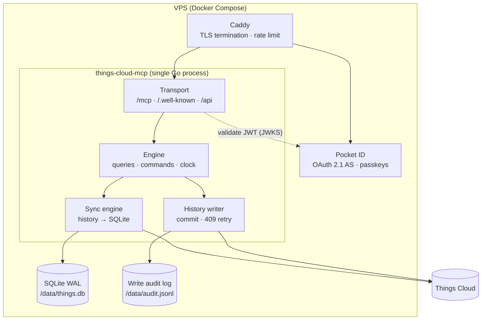
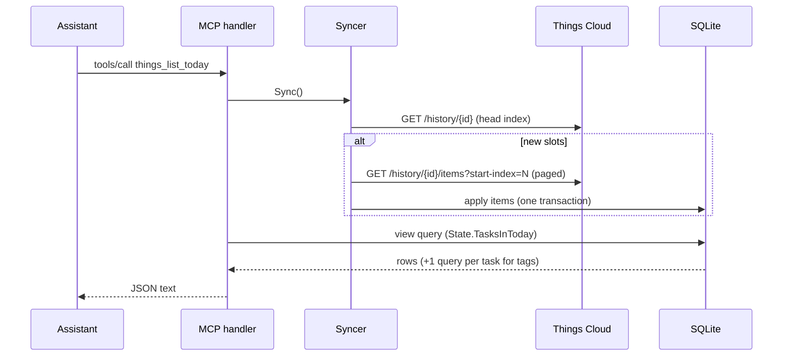
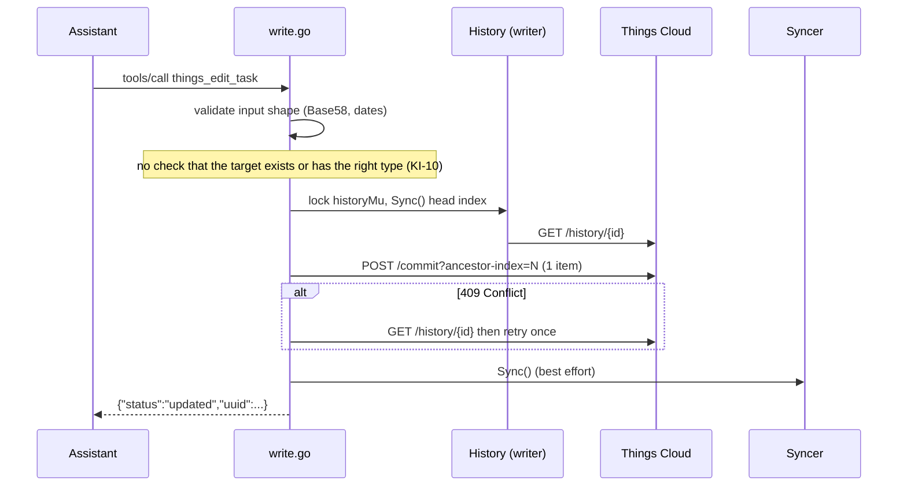
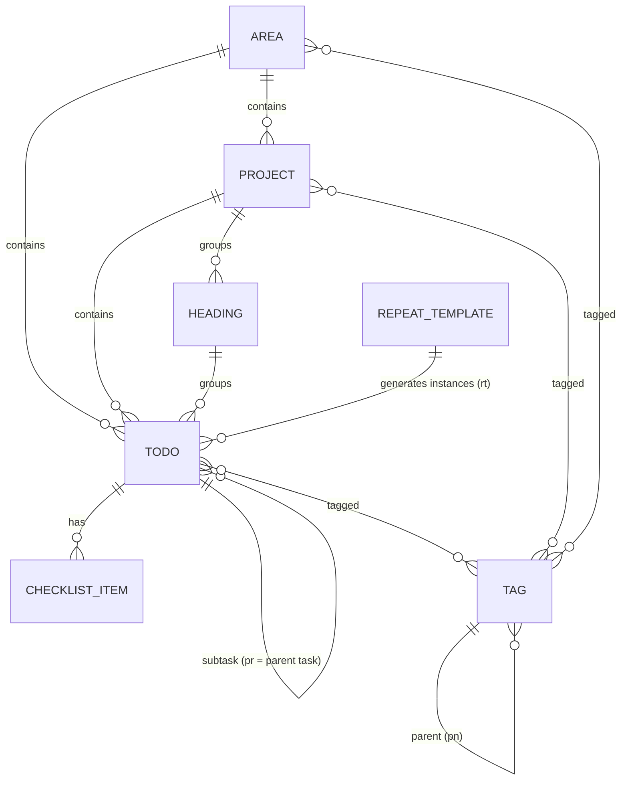
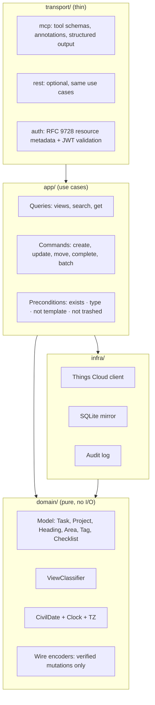

# Architecture

Current state (baseline `3164e8a`) and target state of the Things Cloud MCP server.
Decisions that move us from one to the other live in [`docs/adr/`](adr/).

## 1. Goal and constraints

**Goal.** One person manages their Things 3 tasks from any device (iPhone, iPad, Mac,
web) through Claude or ChatGPT, from anywhere, without a Mac being online.

**Hard constraints**

| Constraint | Consequence |
|---|---|
| Things has no public API; only the private Things Cloud sync protocol | We speak that protocol directly and own every byte we write (see [`protocol/things-cloud.md`](protocol/things-cloud.md)) |
| Things Cloud accepts any payload and lets clients choke on it | All validation happens in this server; write paths must be evidence-based |
| Claude/ChatGPT call remote MCP servers from their own cloud, not from the phone | The server must be reachable over public HTTPS and must authenticate callers (OAuth) |
| Single user, single Things account | No multi-tenancy; SQLite is enough; one process |
| Repetition, Today "confirmation" and similar logic run inside the Things apps | The server sees their results only after an app syncs; some views must be derived |

**Quality attributes, in priority order:** data safety → correctness of views →
security → operability → latency → breadth of features.

## 2. System context

The server is just another sync client of Things Cloud, next to the official apps.

## 3. Containers

Today `transport` and `engine` are fused in `server/` with package-level globals, there
is no OAuth, no audit log, and deployment targets Fly.io. The target split is described
in §7.

## 4. Code map (current)

| Path | Role | Notes |
|---|---|---|
| `server/main.go` | Process wiring, REST handlers, debug endpoints, graceful shutdown | Globals `client`, `syncer`, `history`; hard-coded `/data/things.db` |
| `server/mcp.go` | MCP tool registry (36 tools) and read handlers, output formatting | `mark3labs/mcp-go` v0.44, Streamable HTTP, stateless |
| `server/write.go` | All write commands, wire payload builders, `historyWrite` | One item per commit; global `historyMu` |
| `server/json_body.go` | Bounded JSON body decoding for REST | |
| `sync/sync.go` | `Syncer`: incremental pull, paging, retries, cursor persistence | Serialised by `Syncer.mu` |
| `sync/process.go` | Applies history items to SQLite inside one transaction; tombstones | Field-by-field merge in `applyTaskPayload` |
| `sync/store.go` | Row ⇄ `things.Task` mapping | Drops `rr`, `rt`, `sb`, `dds` |
| `sync/state.go` | Read model: view queries (Inbox/Today/Anytime/Someday/Upcoming/…) | UTC-based; see KI-02/KI-03 |
| `sync/detect.go`, `sync/changes.go` | Semantic change detection (40+ change types) | Used by `thingsync`, not by the MCP tools |
| `sync/schema.go` | SQLite schema v4 and migrations | v4 wipes the cache to force resync |
| `*.go` (root, package `thingscloud`) | SDK: HTTP client, histories, items, wire types, notes, repeat maths, account | Module path still `github.com/arthursoares/things-cloud-sdk` |
| `state/memory/` | In-memory aggregation of items | Used by CLI tools and tests only |
| `syncutil/` | Helpers for CLI analytics | |
| `cmd/` | 14 CLI/debug tools (`things-cli`, `thingsync`, tracers, dumpers) | Some duplicate the server's wire format (divergence risk) |
| `tests/*.sh` | Black-box scripts against a deployed server | Hit a real account; must target a sandbox |
| `tapes/` | Recorded HTTP responses for SDK unit tests | |

## 5. Runtime flows (current)

### 5.1 Read

Every read costs at least one round trip to Things Cloud. Sync failures surface as
tool errors (since 2026-03-05) instead of stale data.

### 5.2 Write

A write costs three to five round trips and returns no resulting state.

## 6. Domain model

Ubiquitous language (use these words in code, tools and docs):

| Term | Meaning | Wire |
|---|---|---|
| To-do / task | Actionable item | `Task6`, `tp=0` |
| Project | Container of to-dos with an outcome | `Task6`, `tp=1` |
| Heading | Section inside a project | `Task6`, `tp=2` |
| Area | Long-lived responsibility containing projects and to-dos | `Area3` |
| Start state | Inbox / started / deferred | `st` |
| When / start date | Day the item becomes active | `sr` (+`tir` for Today) |
| This Evening | Sub-section of Today | `sb=1` |
| Deadline | Hard due date | `dd` |
| Logbook | Completed or canceled items | `ss∈{2,3}` |
| Repeating template / instance | Hidden rule-bearing item / generated copy | `rr` / `rt` |
| Civil date | A calendar date in the owner's timezone, no time | encoded as midnight UTC |

## 7. Target architecture

Principles:

1. **One `Engine` value** owns config, clock, cloud client, syncer, writer and audit
   log. No package-level mutable state. Handlers receive it explicitly.
2. **Domain is pure.** View classification, date maths and wire encoding are pure
   functions of (entity, today, timezone) and are table-tested.
3. **Commands are validated against the mirror before any byte leaves the process**
   (ADR-0004), committed as one history commit (single or batch), audited, then
   read back and returned.
4. **Wire encoders are an allowlist.** A mutation that is not backed by a capture
   fixture does not have an encoder and therefore cannot be sent.
5. **Reads are freshness-bounded.** Sync on read, but coalesce concurrent syncs and
   skip if the last successful sync is younger than a small window (e.g. 2 s), so a
   burst of tool calls costs one round trip.
6. **Transport is replaceable.** Upgrading `mcp-go` or switching to the official Go
   SDK touches only `transport/`.

Migration is incremental (strangler): extract `domain/civil` and `domain/view` first
(fixes KI-02/03), then `Engine`, then preconditions and the allowlist, then OAuth.
See [`roadmap.md`](roadmap.md).

## 8. Cross-cutting concerns

| Concern | Current | Target |
|---|---|---|
| AuthN to the server | none on `/mcp`; optional static bearer on `/api` | OAuth 2.1 single-user (ADR-0002) |
| Secrets | env vars; password logged in `DEBUG` (KI-09) | env/secret files; redaction tested |
| Time | UTC everywhere | owner's IANA timezone, injectable clock (ADR-0003) |
| Observability | `log.Printf` | structured logs (`log/slog`), request id, write audit log, `/healthz` + `/readyz` |
| Backups | none | nightly copy of SQLite + audit log; the cloud stays the source of truth |
| Testing | unit + tapes; shell scripts against real account | unit, captures, conformance snapshots, sandbox e2e (ADR-0005, ADR-0007) |
