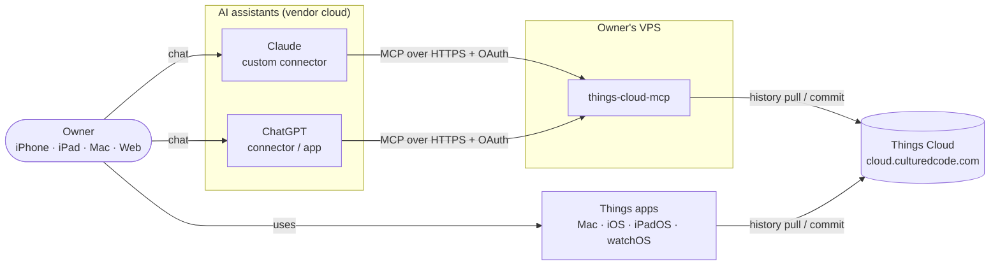
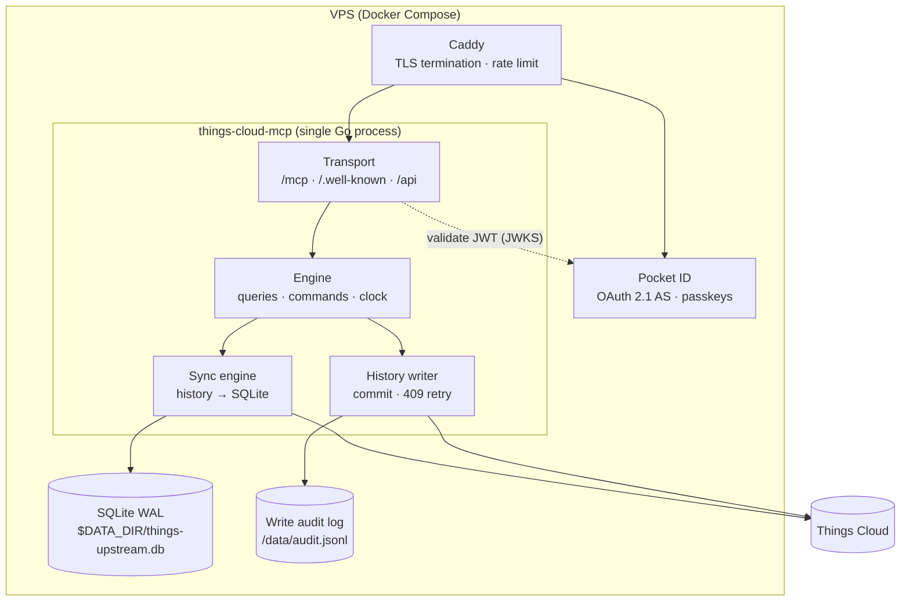
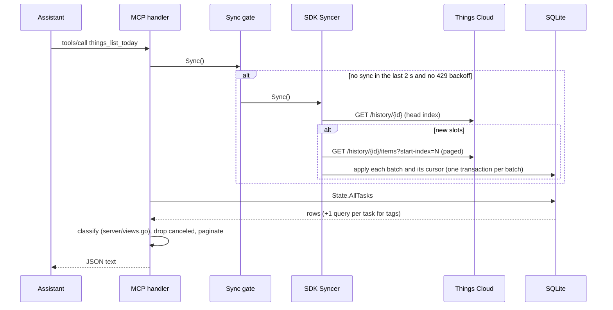
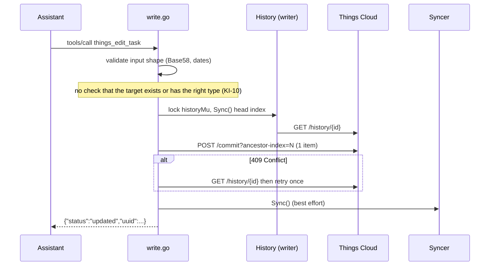
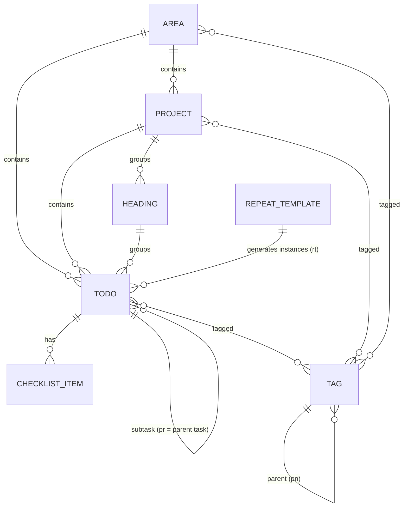
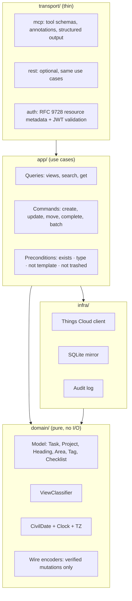

# Architecture

Current state (after the upstream SDK migration, ADR-0001, 2026-10-11) and target state
of the Things Cloud MCP server.
Decisions that move us from one to the other live in [`docs/adr/`](adr/).

## 1. Goal and constraints

**Goal.** One person manages their Things 3 tasks from any device (iPhone, iPad, Mac,
web) through Claude or ChatGPT, from anywhere, without a Mac being online.

**Hard constraints**

| Constraint | Consequence |
|---|---|
| Things has no public API; only the private Things Cloud sync protocol | We speak that protocol directly and own every byte we write (see [`protocol/things-cloud.md`](protocol/things-cloud.md)) |
| Things Cloud accepts any payload and lets clients choke on it | All validation happens in this server; write paths must be evidence-based |
| Claude/ChatGPT call remote MCP servers from their own cloud, not from the phone | The server must be reachable over public HTTPS and must authenticate callers (OAuth) |
| Single user, single Things account | No multi-tenancy; SQLite is enough; one process |
| Repetition, Today "confirmation" and similar logic run inside the Things apps | The server sees their results only after an app syncs; some views must be derived |

**Quality attributes, in priority order:** data safety → correctness of views →
security → operability → latency → breadth of features.

## 2. System context

The server is just another sync client of Things Cloud, next to the official apps.

## 3. Containers

Today `transport` and `engine` are fused in `server/` with package-level globals, there
is no audit log, and the OAuth resource server (`server/auth.go`) has not been run against
Pocket ID yet. The target split is described
in §7.

## 4. Code map (current)

This module (`github.com/pachamaker/things-cloud-mcp`) contains only the server. The
protocol client and the sync engine are the
[`arthursoares/things-cloud-sdk`](https://github.com/arthursoares/things-cloud-sdk)
dependency, pinned in `go.mod` (v0.6.0) and replaced by one commit of the fork
`pachamaker/things-cloud-sdk` that carries the fixes proposed upstream (`rr`/`rt`,
`sb`/`dds`/`tir`, tombstones without a target; ADR-0001). Differences from the embedded
copy this repo used to carry: `docs/2026-10-10-upstream-sdk-spike.md` §3–§4.

| Path | Role | Notes |
|---|---|---|
| `server/main.go` | Process wiring, router, REST handlers, graceful shutdown | Globals `client`, `mirrorDB`, `mirror`, `history`; cache at `$DATA_DIR/things-upstream.db` |
| `server/mirror.go` | Owns the mirror file and its Syncer; history check (account key + head vs the stored key + cursor) and rebuild | KI-28; one backup `things-upstream.db.before-rebuild` |
| `server/auth.go` | OAuth resource server: config, JWKS cache, RFC 9068 token checks, RFC 9728 metadata, per-tool scopes | Every data route goes through a `gate` (KI-07) |
| `server/mcp.go` | MCP tool registry and read handlers, output formatting | `mark3labs/mcp-go` v0.44, Streamable HTTP, stateless |
| `server/write.go` | All write commands, wire payload builders, ID generator, `historyWrite` | One item per commit; global `historyMu`; `repeat` always rejected (KI-01) |
| `server/readmodel.go` | Read model over SDK `State`: pagination, open-list filtering (canceled excluded), completed range | Loads full lists, then pages in Go (KI-18) |
| `server/views.go` | View classifier (Inbox/Today/Anytime/Someday/Upcoming, This Evening) over `State.AllTasks` | Compares civil dates against the owner's day; reads `dds` and `sb`, not `tir` (KI-02) |
| `server/today.go` | `THINGS_TIMEZONE` parsing, `ownerToday()` | Global `ownerZone`, set once in `main` |
| `domain/civil` | Civil date, clock, owner's "today", wire encoding of day values, zone loading (ADR-0003) | Pure; embeds `time/tzdata` |
| `server/syncgate.go` | Serialises and coalesces `Syncer.Sync()`, backs off on 429, runs history checks and background rebuilds with backoff, logs the history items the SDK skips | The SDK `Syncer` has no lock (KI-27, KI-28); skipped items: KI-29 |
| `server/json_body.go` | Bounded JSON body decoding for REST | |
| `server/redact.go` | Hides the URL of a failed Things Cloud request where SDK errors enter the server (sync gate, `historyWrite`, startup) | The URL carries the history key, a bearer capability (KI-35) |
| SDK `thingscloud` | HTTP client, histories, items, wire types (`Task6`/`Task7`), Base58 codec, notes, account | `History.Write` refuses non-canonical IDs |
| SDK `sync` | `Syncer`: incremental pull, per-batch cursor, cache replay with backup, SQLite store, `State` queries | The fork stores `rr`, `rt`, `sb`, `dds`, `tir` (`TaskReplayVersion` 5: an older cache is replayed once on first start) and skips tombstones without a target as `ItemSkipped` |
| `tests/*.sh` | Black-box scripts against a deployed server | Hit a real account; must target a sandbox |

## 5. Runtime flows (current)

### 5.1 Read

A burst of reads costs one round trip to Things Cloud. Sync failures surface as
tool errors (since 2026-03-05) instead of stale data.

The gate also keeps the mirror on the account's current history (KI-28): every 15 min on
reads, after a 404 on the mirrored history and before writes (at most a minute old) it
verifies the account's history key, reads that history's head and compares both with the
key and cursor stored in the mirror. A stale mirror is set aside as
`things-upstream.db.before-rebuild` and rebuilt from index 0 in the background; calls fail
fast with a "being rebuilt" error until it is done, and rebuilds back off up to an hour.

### 5.2 Write

A write costs three to five round trips and returns no resulting state.

## 6. Domain model

Ubiquitous language (use these words in code, tools and docs):

| Term | Meaning | Wire |
|---|---|---|
| To-do / task | Actionable item | `Task6`/`Task7`, `tp=0` |
| Project | Container of to-dos with an outcome | `Task6`/`Task7`, `tp=1` |
| Heading | Section inside a project | `Task6`/`Task7`, `tp=2` |
| Area | Long-lived responsibility containing projects and to-dos | `Area3` |
| Start state | Inbox / started / deferred | `st` |
| When / start date | Day the item becomes active | `sr` (+`tir` for Today) |
| This Evening | Sub-section of Today | `sb=1` |
| Deadline | Hard due date | `dd` |
| Logbook | Completed or canceled items | `ss∈{2,3}` |
| Repeating template / instance | Hidden rule-bearing item / generated copy | `rr` / `rt` |
| Civil date | A calendar date in the owner's timezone, no time | encoded as midnight UTC |

## 7. Target architecture

Principles:

1. **One `Engine` value** owns config, clock, cloud client, syncer, writer and audit
   log. No package-level mutable state. Handlers receive it explicitly.
2. **Domain is pure.** View classification, date maths and wire encoding are pure
   functions of (entity, today, timezone) and are table-tested.
3. **Commands are validated against the mirror before any byte leaves the process**
   (ADR-0004), committed as one history commit (single or batch), audited, then
   read back and returned.
4. **Wire encoders are an allowlist.** A mutation that is not backed by a capture
   fixture does not have an encoder and therefore cannot be sent.
5. **Reads are freshness-bounded.** Sync on read, but coalesce concurrent syncs and
   skip if the last successful sync is younger than a small window (e.g. 2 s), so a
   burst of tool calls costs one round trip.
6. **Transport is replaceable.** Upgrading `mcp-go` or switching to the official Go
   SDK touches only `transport/`.

Migration is incremental (strangler): extract `domain/civil` and `domain/view` first
(fixes KI-02/03), then `Engine`, then preconditions and the allowlist, then OAuth.
See [`roadmap.md`](roadmap.md).

## 8. Cross-cutting concerns

| Concern | Current | Target |
|---|---|---|
| AuthN to the server | OAuth 2.1 bearer tokens on `/mcp` and `/api` (`server/auth.go`), or local-only without auth on `127.0.0.1` | same, verified end to end with Pocket ID (ADR-0002) |
| Secrets | env vars; password logged in `DEBUG` (KI-09) | env/secret files; redaction tested |
| Time | owner's IANA timezone (`THINGS_TIMEZONE`, UTC if unset) through `domain/civil`; pure date logic takes `today` | injectable clock end to end (ADR-0003) |
| Observability | `log.Printf` | structured logs (`log/slog`), request id, write audit log, `/healthz` + `/readyz` |
| Backups | none | nightly copy of SQLite + audit log; the cloud stays the source of truth |
| Testing | unit tests in `server/`; shell scripts against real account | unit, captures, conformance snapshots, sandbox e2e (ADR-0005, ADR-0007) |
