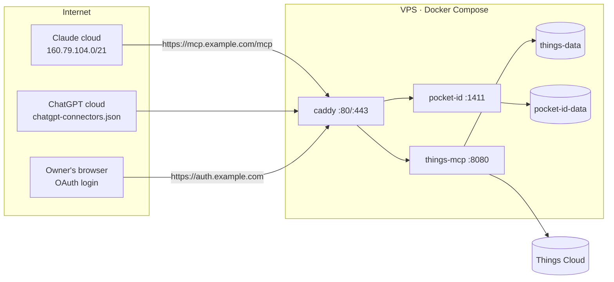

# Self-hosting on a VPS (Claude + ChatGPT, any device)

Target deployment from [ADR-0002](../adr/0002-remote-deployment-and-auth.md). Replaces
the Fly.io guide in [`../installation.md`](../installation.md).

> **Status.** `things-mcp` is an OAuth 2.1 resource server (KI-07): every data route needs
> an access token for the owner, and the server does not start without the OAuth settings
> below. The full sign-in through Pocket ID from Claude and ChatGPT has **not been verified
> end to end yet** (roadmap Phase 2): do the first connection against a sandbox Things
> account and check §6.3.

## 1. Topology



Only Caddy publishes ports. `things-mcp` and `pocket-id` are reachable only on the
internal Docker network.

## 2. Prerequisites

| Item | Recommendation |
|---|---|
| VPS | 1 vCPU, 1 GB RAM, 10 GB disk; Ubuntu 24.04 LTS or Debian 13 |
| Region | Close to Things Cloud (AWS) and the assistants' egress, e.g. Frankfurt/Amsterdam; avoid networks that filter traffic to AWS/Anthropic/OpenAI |
| IPv4 | **Required.** Claude connectors are IPv4-only |
| Domain | Two names with A records: `mcp.example.com`, `auth.example.com` |
| Software | Docker Engine + Compose plugin |
| Accounts | Things Cloud account (start with a **sandbox** account), Claude and/or ChatGPT |

## 3. Host hardening (once)

```bash
adduser deploy && usermod -aG sudo,docker deploy
```

- SSH: keys only (`PasswordAuthentication no`, `PermitRootLogin no`).
- Firewall: `ufw allow 22,80,443/tcp && ufw enable`. Docker-published ports bypass
  `ufw`, which is why only Caddy publishes anything.
- Automatic security updates: `unattended-upgrades`.
- Optional: `fail2ban` for SSH and for failed logins on `auth.example.com`. Never
  block the assistants' egress ranges on `/mcp` or the token endpoint.

## 4. Files

```
/opt/things-mcp/
├── compose.yaml
├── Caddyfile
├── secrets/
│   └── things.env        # chmod 600, never committed
└── src/                  # git clone of this repository (until images are published)
```

`secrets/things.env`:

```bash
THINGS_USERNAME=you@example.com
THINGS_PASSWORD=change-me
# Off by default: without it the server is read-only (ADR-0004).
ENABLE_WRITES=true
# OAuth (KI-07). All three are required; the server refuses to start without them.
MCP_PUBLIC_URL=https://mcp.example.com/mcp
OAUTH_ISSUER=https://auth.example.com
OAUTH_ALLOWED_SUBJECT=<your Pocket ID user id, the sub of its tokens>
# Optional: accept tokens only from these OAuth clients (comma-separated client ids).
# OAUTH_ALLOWED_CLIENTS=<claude client id>,<chatgpt client id>
# Optional: serve /api/* behind the same tokens.
# ENABLE_REST_API=true
# planned (ADR-0003):
# THINGS_TIMEZONE=Europe/Moscow
```

`compose.yaml`:

```yaml
services:
  caddy:
    image: caddy:2.11
    restart: unless-stopped
    ports: ["80:80", "443:443"]
    volumes:
      - ./Caddyfile:/etc/caddy/Caddyfile:ro
      - caddy-data:/data
      - caddy-config:/config
    networks: [edge]

  things-mcp:
    build: ./src            # later: image: ghcr.io/pachamaker/things-cloud-mcp:<version>
    restart: unless-stopped
    env_file: ./secrets/things.env
    volumes:
      - things-data:/data
    networks: [edge]
    healthcheck:
      test: ["CMD", "wget", "-qO-", "http://127.0.0.1:8080/"]
      interval: 30s
      timeout: 5s
      retries: 3

  pocket-id:
    image: ghcr.io/pocket-id/pocket-id:v2   # pin an exact version, v2.14 or newer
    restart: unless-stopped
    environment:
      APP_URL: https://auth.example.com
      TRUST_PROXY: "true"
    volumes:
      - pocket-id-data:/app/data
    networks: [edge]

networks:
  edge: {}

volumes:
  caddy-data: {}
  caddy-config: {}
  things-data: {}
  pocket-id-data: {}
```

Check Pocket ID's documentation for the environment variables of the version you pin.

`Caddyfile`:

```caddyfile
mcp.example.com {
	encode zstd gzip
	reverse_proxy things-mcp:8080
}

auth.example.com {
	reverse_proxy pocket-id:1411
}
```

Caddy reaches the app over the Docker network (not loopback), so `mcp-go`'s
DNS-rebinding protection (v0.56+, after the planned upgrade) will accept the forwarded
`Host`; on `/mcp` the OAuth token is what keeps other sites out. Caddy's access logs redact
`Authorization` and cookies by default.

Start:

```bash
cd /opt/things-mcp && docker compose up -d --build && docker compose logs -f things-mcp
```

The server performs a full initial sync and exits if it fails (wrong credentials,
Things Cloud unreachable). It then loads Pocket ID's signing keys from `OAUTH_ISSUER` and
logs `Auth: loaded N signing key(s)`; a warning there means the container cannot reach the
issuer yet (Pocket ID still starting, DNS, or a firewall), and requests get `503` until it
can. The container fetches `https://auth.example.com` over the public name, so the VPS
must be able to reach its own address.

## 5. Identity provider (Pocket ID)

Needs Pocket ID v2.14 or newer (APIs with permissions, RFC 9068 access tokens, CIMD,
RFC 8414 metadata). Menu names below are from v2.18.

1. Open `https://auth.example.com`, create the admin user, register a passkey on your
   phone and laptop.
2. **Administration → APIs → add an API** for `things-mcp`:
   - resource: `https://mcp.example.com/mcp`, exactly `MCP_PUBLIC_URL` (tokens carry it as
     `aud`; the resource cannot be changed later);
   - permissions: `things.read` and `things.write`.
3. **Administration → OIDC Clients**, one per assistant. On each client's **Access** tab,
   add the API with user-delegated access and choose its permissions; restrict the
   client to a user group that contains only you.
   - **Claude:** a public client (PKCE) with callback
     `https://claude.ai/api/mcp/auth_callback`. Alternatively Claude's published identity
     (CIMD) works only with the API's **Allow all metadata document clients** switch, which
     grants the API to every CIMD client; if you use it, set `OAUTH_ALLOWED_CLIENTS` to
     Claude's client id.
   - **ChatGPT:** a confidential client with the exact callback URL shown in the plugin's
     settings. Grant only `things.read` until you have checked that your plan allows
     write tools.
4. Put your user id (the `sub` claim of your tokens) into `OAUTH_ALLOWED_SUBJECT`, and
   optionally the client ids into `OAUTH_ALLOWED_CLIENTS`; restart `things-mcp`.

What the server accepts: a JWT signed with a key from Pocket ID's JWKS (asymmetric
algorithms only), header `typ` `at+jwt`, `iss` = `OAUTH_ISSUER`, `aud` containing
`MCP_PUBLIC_URL`, not expired (one minute leeway), `sub` = `OAUTH_ALLOWED_SUBJECT`, and the
scope `things.read`. Write tools also need `things.write` and `ENABLE_WRITES=true`: a
read-only token does not even see them.

## 6. Connect the assistants

### 6.1 Claude (web, desktop, then mobile)
1. claude.ai → **Customize → Connectors → Add custom connector**.
2. URL `https://mcp.example.com/mcp`; OAuth client: "Use your own OAuth client" with the
   client id from step 5 (or "Use Claude's published identity" with the CIMD setup).
3. Sign in with your passkey and approve.
4. The connector appears on iPhone/iPad after the next login to the Claude app.
5. Per tool, set write tools to "Ask" (default for `destructiveHint`) and read tools to
   "Always allow" if you like.

### 6.2 ChatGPT (web, then mobile)
1. `chatgpt.com/plugins` → **+** → **Add custom MCP server**.
2. URL `https://mcp.example.com/mcp`, authentication **OAuth**, static client
   credentials from step 5.
3. Install the plugin and call it with `@` in a chat.
4. Check whether your plan allows write tools; until then keep the client on
   `things.read`.

### 6.3 Check the setup

```bash
curl -s https://mcp.example.com/.well-known/oauth-protected-resource/mcp
curl -si -X POST https://mcp.example.com/mcp | grep -i '^www-authenticate'
```

The first prints `resource` = `https://mcp.example.com/mcp` and
`authorization_servers` = `["https://auth.example.com"]`; the second shows
`Bearer resource_metadata="https://mcp.example.com/.well-known/oauth-protected-resource/mcp"`.
After connecting, `docker compose logs things-mcp | grep auth:` must not show rejected
tokens. For the first connection, use a sandbox Things account.

## 7. Backups

| What | Why | How |
|---|---|---|
| `things-data` volume | Write audit log (`audit.jsonl`, planned); the SQLite mirror itself is a rebuildable cache. The server keeps no OAuth state: it only validates tokens | Nightly `VACUUM INTO` copy or Litestream to S3-compatible storage; copy off the box |
| `pocket-id-data` | Users, passkeys, clients | Nightly volume snapshot |
| Things history export (planned, read-only job built on the SDK's `History.Items`) | Independent copy of the account history for diagnosing a bad write | Nightly JSON dump, 30-day retention |
| Things itself | Source of truth | Things for Mac keeps local backups; keep them enabled |

Test a restore once: stop the stack, restore volumes on a fresh VM, start, verify.

## 8. Monitoring

- External uptime checks (Uptime Kuma or healthchecks.io):
  - `GET https://mcp.example.com/.well-known/oauth-protected-resource/mcp` → 200
  - `GET https://mcp.example.com/mcp` without token → 401
  - TLS certificate expiry
- Heartbeat ping from the backup job.
- `docker compose ps` restarts and `docker compose logs things-mcp` for sync errors
  (`429`, `409`, `404 AccountIssue`).

## 9. Updating

Upgrading from a version before KI-07: the server refuses to start until the OAuth
settings from §4 are in `secrets/things.env`, and while `API_KEY` is still set.

```bash
cd /opt/things-mcp/src && git fetch && git checkout <tag>
cd .. && docker compose up -d --build
docker compose logs --since 5m things-mcp
```

After an update, ask the assistant to list Today and compare with the Things app.
Schema migrations may wipe and rebuild the mirror; the first sync after such an update
takes longer.

## 10. Troubleshooting

| Symptom | Likely cause |
|---|---|
| Claude never shows a sign-in button | `/mcp` answers 200 instead of 401 for unauthenticated requests |
| Server exits: "authentication is not configured" | `OAUTH_ISSUER`, `MCP_PUBLIC_URL`, `OAUTH_ALLOWED_SUBJECT` missing from `secrets/things.env` |
| Sign-in succeeds, then every call fails with 401 | `docker compose logs things-mcp \| grep auth:` names the reason: audience (API resource ≠ `MCP_PUBLIC_URL`, or the client sent no `resource`), subject (`OAUTH_ALLOWED_SUBJECT`), client (`OAUTH_ALLOWED_CLIENTS`), `typ` |
| 403 `insufficient_scope` | The client is not granted `things.read` (or `things.write` for writes) on the API's Access tab |
| Write tools missing in the assistant | Token without `things.write`, or `ENABLE_WRITES` is not `true` |
| 503 "authorization server unavailable" | `things-mcp` cannot fetch Pocket ID's metadata or keys; check the startup log line `Auth:` |
| Claude: "resource mismatch" | Protected-resource `resource` differs from the URL typed (path included) |
| Connection fails only for Claude | No A record (IPv6-only host) or a WAF blocking `160.79.104.0/21` |
| 403 from the app behind a proxy on the same host | After the `mcp-go` v1.x upgrade: its DNS-rebinding protection; proxy to the container network, or `header_up Host localhost`. In local-only mode: the request's `Host` or `Origin` is not loopback |
| Tools time out | Things Cloud slow or rate-limited (429); see logs |
| Server exits at start | Initial sync failed: credentials, network, or Things Cloud error |
| Tasks from the Things app missing | KI-25 (`Task7` not read) on versions before the fix |
