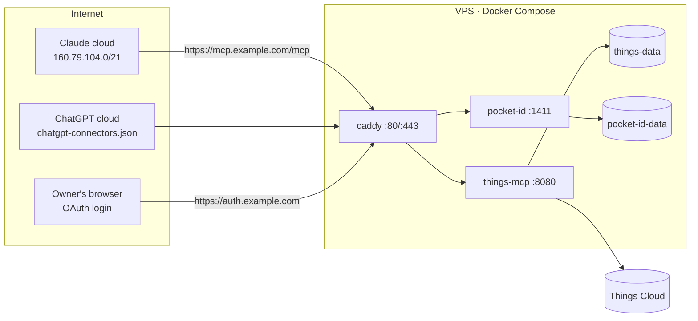

# Self-hosting on a VPS (Claude + ChatGPT, any device)

Target deployment from [ADR-0002](../adr/0002-remote-deployment-and-auth.md). Replaces
the Fly.io guide in [`../installation.md`](../installation.md).

> **Verified deployment.** The maintainer ran Things Cloud MCP v2.0.1 and Pocket ID
> v2.19.2 in Docker Compose on a Linux VPS. Cloudflare proxied HTTPS to Nginx on the
> VPS, and Nginx forwarded requests to both services on loopback. Scoped Cloudflare Access
> policies allowed machine-to-machine OAuth and MCP requests to reach the services
> while keeping Pocket ID administration behind Access. ChatGPT web used a confidential
> OAuth client with PKCE, PAR disabled, and passkey sign-in. The maintainer verified
> task lookup against the VPS mirror with `things.read`. After enabling writes and
> reauthorizing with `things.write`, the maintainer created one ordinary Inbox task
> through ChatGPT and confirmed it in Things for Mac and in the mirror.
>
> Caddy is the reference setup below. A clean install using it, Claude, and mobile
> clients are outside the recorded end-to-end verification. Use a sandbox Things account
> for your first connection and follow §6.3.

## Cloudflare is optional

**DNS → Caddy → Things Cloud MCP + Pocket ID**

- Point `mcp.example.com` and `auth.example.com` to the VPS public IPv4 with
  DNS A records at any provider.
- Use a Linux VPS with Docker Engine and the Compose plugin. Allow incoming TCP
  ports 80 and 443 so Caddy can obtain public TLS certificates and serve HTTPS.
- Use a Things Cloud account and an MCP client that supports remote OAuth.
  Start with a separate test account.
- Allow the VPS to reach Things Cloud and the public Pocket ID hostname over HTTPS.

Caddy routes the MCP hostname to Things Cloud MCP and the auth hostname to Pocket ID.
Both services stay on the internal Docker network.

## 1. Topology



Only Caddy publishes ports. `things-mcp` and `pocket-id` are reachable only on the
internal Docker network.

## 2. Prerequisites

| Item | Recommendation |
|---|---|
| VPS | 1 vCPU, 1 GB RAM, 10 GB disk; Ubuntu 24.04 LTS or Debian 13 |
| Region | Close to Things Cloud (AWS) and the assistants' egress, e.g. Frankfurt/Amsterdam; avoid networks that filter traffic to AWS/Anthropic/OpenAI |
| IPv4 | **Required.** Claude connectors are IPv4-only |
| Domain | Two names with A records: `mcp.example.com`, `auth.example.com` |
| Software | Docker Engine, Compose plugin, OpenSSL |
| Accounts | Things Cloud account (start with a **sandbox** account), Claude and/or ChatGPT |

## 3. Host hardening (once)

```bash
adduser deploy && usermod -aG sudo,docker deploy
```

- SSH: keys only (`PasswordAuthentication no`, `PermitRootLogin no`).
- Firewall: `ufw allow 22,80,443/tcp && ufw enable`. Docker-published ports bypass
  `ufw`, which is why only Caddy publishes anything.
- Automatic security updates: `unattended-upgrades`.
- Optional: `fail2ban` for SSH and for failed logins on `auth.example.com`. Never
  block the assistants' egress ranges on `/mcp` or the token endpoint.

## 4. Files

```
/opt/things-mcp/
├── compose.yaml
├── Caddyfile
└── secrets/
    ├── things.env        # chmod 600, never committed
    └── pocket-id.env     # chmod 600, never committed
```

### Image

`things-mcp` runs the release image `ghcr.io/pachamaker/things-cloud-mcp:<tag>`, built
for linux/amd64 and linux/arm64 by `.github/workflows/release.yml` when the owner pushes
a `v*` tag, after the CI checks pass. Each release is tagged `vX.Y.Z` and
`sha-<short commit>`; there is no `latest`, so pin an exact tag, optionally with its
digest from `docker buildx imagetools inspect ghcr.io/pachamaker/things-cloud-mcp:<tag>`.

What is inside (KI-16):

- One static Go binary (`CGO_ENABLED=0`; SQLite is pure Go, zone data is built in) on
  `gcr.io/distroless/static-debian13:nonroot`: CA certificates, no shell, no package
  manager. Base images are pinned by digest, and a rebuild of the same commit gives the
  same platform images.
- Runs as uid/gid `65532` (`nonroot`). `/data` belongs to that user with mode `0700`; a
  new named volume mounted there inherits both.
- `HEALTHCHECK`: `things-server healthcheck` requests the public `/` on `127.0.0.1:$PORT`
  and fails unless it answers `200`. `/` returns only the service name, status and
  version. The server listens only after its initial sync, so the container is
  `starting` for up to 5 minutes and then `healthy`; the check does not test Things Cloud
  or the issuer (use §8 for those).
- The version is the tag: `docker compose logs things-mcp | grep 'Starting server'`, or
  `serverInfo.version` in MCP.

The first release creates the GHCR package. If `docker compose pull` answers `denied` or
`unauthorized`, the package is private: make it public in its GitHub package settings,
or `docker login ghcr.io` on the VPS with a token that has only `read:packages`.

To run an unreleased commit instead, clone the repository into `src/` and replace
`image:` with `build: {context: ./src, args: {VERSION: <commit>}}`; that builds from the
same `Dockerfile`.

### Environment

| Variable | In `secrets/things.env` |
|---|---|
| `THINGS_USERNAME`, `THINGS_PASSWORD` | Required. The Things Cloud account the server syncs |
| `MCP_PUBLIC_URL`, `OAUTH_ISSUER`, `OAUTH_ALLOWED_SUBJECT` | Required (KI-07): without them the server refuses to start. `OAUTH_ALLOWED_CLIENTS` is optional |
| `ENABLE_WRITES` | `true` to register write tools; unset means read-only (ADR-0004) |
| `THINGS_TIMEZONE` | Set it to your IANA zone: decides "today" (ADR-0003); unset means the UTC day |
| `ENABLE_REST_API` | Optional, off by default |
| `DATA_DIR` | Leave unset: the cache lives in `/data`, the volume below. If you change it, mount a volume writable by uid `65532` at that path |
| `PORT` | Leave unset (`8080`). The health check reads the same variable |
| `INSECURE_NO_AUTH_LOCAL_ONLY` | Never on a VPS: the server would listen on the container's loopback only and be unreachable |

`secrets/things.env`:

```bash
THINGS_USERNAME=you@example.com
THINGS_PASSWORD=change-me
# Start read-only. Enable writes after the read check in §6.3.
# ENABLE_WRITES=true
# OAuth (KI-07). All three are required; the server refuses to start without them.
MCP_PUBLIC_URL=https://mcp.example.com/mcp
OAUTH_ISSUER=https://auth.example.com
# Fill in after creating your Pocket ID account in §5.
OAUTH_ALLOWED_SUBJECT=
# Optional: accept tokens only from these OAuth clients (comma-separated client ids).
# OAUTH_ALLOWED_CLIENTS=<claude client id>,<chatgpt client id>
# Optional: serve /api/* behind the same tokens.
# ENABLE_REST_API=true
# Owner's IANA zone: decides "today" (ADR-0003). Unset means the UTC day.
THINGS_TIMEZONE=Europe/Moscow
```

Create `secrets/things.env` with mode `0600` before running Compose. Leave the owner
subject blank until §5.

Generate `secrets/pocket-id.env` once from `/opt/things-mcp`. The command refuses
to overwrite an existing file. Keep the key when recreating the container.

```bash
install -d -m 0700 secrets
(
  umask 077
  set -C
  key=$(openssl rand -base64 32) || exit 1
  printf 'ENCRYPTION_KEY=%s\n' "$key" > secrets/pocket-id.env
)
```

`compose.yaml`:

```yaml
services:
  caddy:
    image: caddy:2.11.9-alpine
    restart: unless-stopped
    ports: ["80:80", "443:443"]
    volumes:
      - ./Caddyfile:/etc/caddy/Caddyfile:ro
      - caddy-data:/data
      - caddy-config:/config
    networks: [edge]

  things-mcp:
    image: ghcr.io/pachamaker/things-cloud-mcp:v2.0.1
    restart: unless-stopped
    env_file: ./secrets/things.env
    volumes:
      - things-data:/data
    networks: [edge]
    cap_drop: [ALL]
    security_opt: ["no-new-privileges:true"]
    # The image brings its own HEALTHCHECK (`things-server healthcheck`).

  pocket-id:
    image: ghcr.io/pocket-id/pocket-id:v2.19.2
    restart: unless-stopped
    env_file: ./secrets/pocket-id.env
    environment:
      APP_URL: https://auth.example.com
      TRUST_PROXY: "true"
    volumes:
      - pocket-id-data:/app/data
    networks: [edge]

networks:
  edge: {}

volumes:
  caddy-data: {}
  caddy-config: {}
  things-data: {}
  pocket-id-data: {}
```

## 5. Bootstrap Pocket ID before starting MCP

Use this temporary `Caddyfile`. Replace `203.0.113.10/32` with the trusted public IPv4
of the operator's browser. This matcher is for the direct setup with DNS pointing at
the VPS. If a CDN or proxy sits in front of Caddy, use an operator-only access policy
at that proxy.

```caddyfile
auth.example.com {
    @operator remote_ip 203.0.113.10/32
    handle @operator {
        reverse_proxy pocket-id:1411
    }
    handle {
        respond 403
    }
}
```

Start only the identity service and its proxy:

```bash
cd /opt/things-mcp
docker compose pull
docker compose up -d caddy pocket-id
```

1. From a second network outside the allowlist, confirm that
   `https://auth.example.com/setup` returns `403`. Then open that URL from the
   allowed browser, create the admin account, and enroll a passkey. Keep a second
   passkey for recovery. [Pocket ID installation](https://pocket-id.org/docs/setup/installation)
2. **Administration → APIs → add an API** for `things-mcp`:
   - resource: `https://mcp.example.com/mcp`, exactly `MCP_PUBLIC_URL` (tokens carry it as
     `aud`; the resource cannot be changed later);
   - permissions: `things.read` and `things.write`.
3. **Administration → OIDC Clients**, one per assistant. On each client's **Access** tab,
   add the API with user-delegated access and choose its permissions; restrict the
   client to a user group that contains only you.
   - **Claude:** a public client (PKCE) with callback
     `https://claude.ai/api/mcp/auth_callback`. Alternatively Claude's published identity
     (CIMD) works only with the API's **Allow all metadata document clients** switch, which
     grants the API to every CIMD client; if you use it, set `OAUTH_ALLOWED_CLIENTS` to
     Claude's client id.
   - **ChatGPT:** a confidential client with PKCE enabled and **Requires Pushed
     Authorization Requests** disabled. Use the exact callback shown in ChatGPT. With
     Pocket ID v2.19.2, the verified callback was
     `https://chatgpt.com/connector_platform_oauth_redirect`. Start with `things.read`.
     After granting `things.write` and enabling writes on the server, reauthorize the
     plugin to obtain a token with the new scope.
4. Copy the owner's Pocket ID user ID into `OAUTH_ALLOWED_SUBJECT` (the token's
   `sub` claim). Optionally set `OAUTH_ALLOWED_CLIENTS` to the allowed client IDs.

Replace the temporary `Caddyfile` with the normal routes. Keep the setup alias,
the setup page, and its API blocked:

```caddyfile
mcp.example.com {
    encode zstd gzip
    reverse_proxy things-mcp:8080
}

auth.example.com {
    @setup path /setup /setup/* /signup/setup /signup/setup/* /api/signup/setup /api/signup/setup/*
    handle @setup {
        respond 403
    }
    handle {
        reverse_proxy pocket-id:1411
    }
}
```

Apply the proxy configuration first:

```bash
docker compose up -d --force-recreate caddy
```

From outside the VPS, confirm that `/setup` and `/signup/setup` return `403` on
the auth hostname and `/.well-known/oauth-authorization-server` returns `200`.
Then start MCP:

```bash
docker compose up -d things-mcp
docker compose ps
```

MCP performs its initial Things Cloud sync before listening. It fetches Pocket ID
signing keys using the public issuer URL. If it cannot reach the issuer,
check DNS, TLS and the VPS firewall. After changing `secrets/things.env`, run
`docker compose up -d --force-recreate things-mcp` to load the new values.

What the server accepts: a JWT signed with a key from Pocket ID's JWKS (asymmetric
algorithms only), header `typ` `at+jwt`, `iss` = `OAUTH_ISSUER`, `aud` containing
`MCP_PUBLIC_URL`, not expired (one minute leeway), `sub` = `OAUTH_ALLOWED_SUBJECT`, and the
scope `things.read`. Write tools also need `things.write` and `ENABLE_WRITES=true`: a
read-only token does not even see them.

If Cloudflare Access protects the hostnames, the MCP endpoint and its protected-resource
metadata must reach the MCP server without a Cloudflare browser session. OAuth discovery,
JWKS and the token endpoint must likewise be reachable by the client. Keep Pocket ID admin
and initial setup routes protected. Before connecting, verify that unauthenticated MCP
requests get a Bearer challenge (`401`), and that metadata returns `200`.

## 6. Connect the assistants

### 6.1 Claude (web, desktop, then mobile)
1. claude.ai → **Customize → Connectors → Add custom connector**.
2. URL `https://mcp.example.com/mcp`; OAuth client: "Use your own OAuth client" with the
   client id from step 5 (or "Use Claude's published identity" with the CIMD setup).
3. Sign in with your passkey and approve.
4. The connector appears on iPhone/iPad after the next login to the Claude app.
5. Per tool, set write tools to "Ask" (default for `destructiveHint`) and read tools to
   "Always allow" if you like.

### 6.2 ChatGPT (web)
1. Open [ChatGPT Plugins](https://chatgpt.com/plugins) → **+** → **Add custom MCP server**.
2. Enter `https://mcp.example.com/mcp` as the server URL. Choose **OAuth** and enter
   the ChatGPT client's ID and secret from Pocket ID (§5).
3. Create and install the plugin. Complete Pocket ID sign-in with your passkey and
   approve access. Use `@` to select the installed plugin in a chat.

Workspace permissions can affect access. See [OpenAI's setup guide](https://developers.openai.com/api/docs/guides/custom-mcp-server).

### 6.3 Check the setup

```bash
curl -fsS https://auth.example.com/.well-known/oauth-authorization-server
curl -fsS https://mcp.example.com/.well-known/oauth-protected-resource/mcp
curl -si -X POST https://mcp.example.com/mcp
```

The issuer metadata must return `200` and advertise a reachable `jwks_uri` that also
returns `200`. The MCP metadata must return `200` with the exact `resource` and
`authorization_servers` URLs. The unauthenticated POST must return `401` with
`WWW-Authenticate: Bearer` pointing to the MCP metadata.

For an authenticated read check, create a uniquely named task in the sandbox account
using Things and wait for it to sync. In ChatGPT web, select the plugin, sign in through
Pocket ID, and check that the plugin exposes read tools with no write tools. Ask it
to find the task by its exact title with `things_search_tasks`, then call
`things_get_task` with the returned `uuid`. Expand the tool result and compare the
title and status with Things. If you have the Things link, compare its ID as well.
This tests the OAuth flow and a real read from the mirror.

## 7. Backups

| What | Why | How |
|---|---|---|
| `things-data` volume | Write audit log (`audit.jsonl`, planned); the SQLite mirror itself is a rebuildable cache. The server keeps no OAuth state: it only validates tokens | Nightly `VACUUM INTO` copy or Litestream to S3-compatible storage; copy off the box |
| `pocket-id-data` and the Pocket ID encryption key | Users, passkeys, clients and encrypted state | Snapshot the volume and back up the key separately. Restore with the original key. |
| Things history export (planned, read-only job built on the SDK's `History.Items`) | Independent copy of the account history for diagnosing a bad write | Nightly JSON dump, 30-day retention |
| Things itself | Source of truth | Things for Mac keeps local backups; keep them enabled |

Test a restore once: stop the stack, restore volumes on a fresh VM, start, verify.

## 8. Monitoring

- External uptime checks (Uptime Kuma or healthchecks.io):
  - `GET https://mcp.example.com/.well-known/oauth-protected-resource/mcp` → 200
  - `GET https://mcp.example.com/mcp` without token → 401
  - TLS certificate expiry
- Heartbeat ping from the backup job.
- `docker compose ps`: restarts and the `healthy`/`unhealthy` state of `things-mcp`;
  `docker compose logs things-mcp` for sync errors (`429`, `409`, `404 AccountIssue`) and
  `[MIRROR]` lines: after a Things Cloud account reset the server rebuilds its cache by
  itself (KI-28) and keeps the old one as `/data/things-upstream.db.before-rebuild`. Delete
  that file once the server reads the new history correctly; it holds the old account's
  tasks. A `rebuilding the local Things mirror failed` error retries on its own with
  backoff up to an hour.

## 9. Updating

Upgrading from a version before KI-07: the server refuses to start until the OAuth
settings from §4 are in `secrets/things.env`, and while `API_KEY` is still set.

Set the new tag in `compose.yaml` (`image: ghcr.io/pachamaker/things-cloud-mcp:<tag>`),
then:

```bash
cd /opt/things-mcp && docker compose pull things-mcp && docker compose up -d
docker compose logs --since 5m things-mcp
```

Rolling back is the same with the previous tag. If the older version cannot open a
cache that a newer one migrated, remove the `things-data` volume: it is a disposable
cache, and the next start performs a full sync.

Upgrading from a build of this repository before the distroless image (KI-16): that
image ran as root, so the files in the `things-data` volume belong to root and the
nonroot server cannot open them. Hand the volume to uid `65532` once, before the first
start of the new image (the volume name carries the Compose project prefix):

```bash
docker compose stop things-mcp
docker run --rm -v things-mcp_things-data:/data alpine:3.24 sh -c 'chown -R 65532:65532 /data && chmod 700 /data'
```

The cache is disposable, so removing the volume instead works too; the next start
performs a full sync.

After an update, ask the assistant to list Today and compare with the Things app.
Schema migrations may wipe and rebuild the mirror; the first sync after such an update
takes longer.

## 10. Troubleshooting

| Symptom | Likely cause |
|---|---|
| Claude never shows a sign-in button | `/mcp` answers 200 instead of 401 for unauthenticated requests |
| Server exits: "authentication is not configured" | `OAUTH_ISSUER`, `MCP_PUBLIC_URL`, `OAUTH_ALLOWED_SUBJECT` missing from `secrets/things.env` |
| Sign-in succeeds, then every call fails with 401 | `docker compose logs things-mcp \| grep auth:` names the reason: audience (API resource ≠ `MCP_PUBLIC_URL`, or the client sent no `resource`), subject (`OAUTH_ALLOWED_SUBJECT`), client (`OAUTH_ALLOWED_CLIENTS`), `typ` |
| 403 `insufficient_scope` | The client is not granted `things.read` (or `things.write` for writes) on the API's Access tab |
| Write tools missing in the assistant | Token without `things.write`, or `ENABLE_WRITES` is not `true` |
| 503 "authorization server unavailable" | `things-mcp` cannot fetch Pocket ID's metadata or keys; check the startup log line `Auth:` |
| Claude: "resource mismatch" | Protected-resource `resource` differs from the URL typed (path included) |
| Connection fails only for Claude | No A record (IPv6-only host) or a WAF blocking `160.79.104.0/21` |
| 403 from the app behind a proxy on the same host | After the `mcp-go` v1.x upgrade: its DNS-rebinding protection; proxy to the container network, or `header_up Host localhost`. In local-only mode: the request's `Host` or `Origin` is not loopback |
| Tools time out | Things Cloud slow or rate-limited (429); see logs |
| Server exits at start | Initial sync failed: credentials, network, or Things Cloud error |
| Server exits: "failed to open sync database: attempt to write a readonly database" | The volume comes from an image that ran as root; hand it to uid `65532` (§9) |
| `docker compose pull`: `denied` or `unauthorized` | The GHCR package is private; make it public or log in with a `read:packages` token (§4 Image) |
| `things-mcp` stays `unhealthy` | The server is not answering on `/`: it crashed or is restarting; see `docker compose logs things-mcp`. `starting` for a few minutes is the initial sync |
| Tasks from the Things app missing | KI-25 (`Task7` not read) on versions before the fix |
