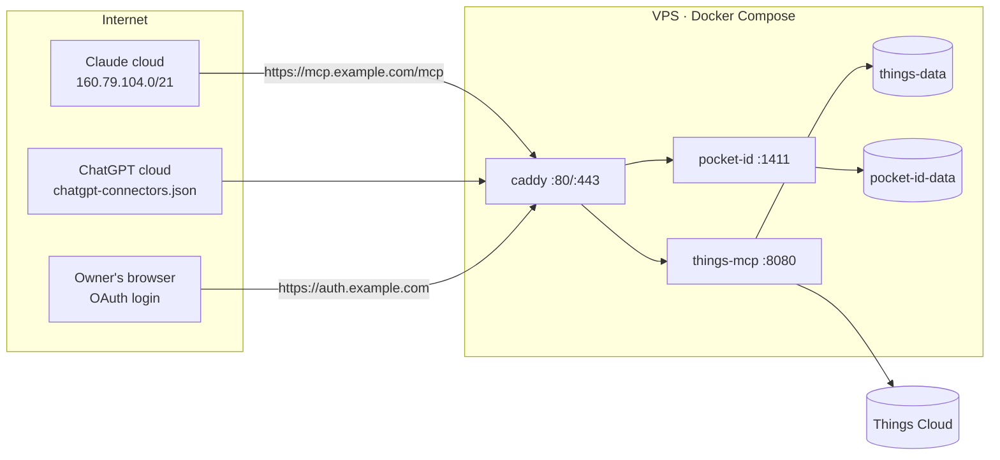

# Self-hosting on a VPS (Claude + ChatGPT, any device)

Target deployment from [ADR-0002](../adr/0002-remote-deployment-and-auth.md). Replaces
the Fly.io guide in [`../installation.md`](../installation.md).

> **Status.** The OAuth parts below require roadmap Phase 2 (resource-server support in
> `things-mcp`). Until it ships, `/mcp` has **no authentication** (KI-07): run the
> server only on localhost or a private network, against a sandbox account.

## 1. Topology



Only Caddy publishes ports. `things-mcp` and `pocket-id` are reachable only on the
internal Docker network.

## 2. Prerequisites

| Item | Recommendation |
|---|---|
| VPS | 1 vCPU, 1 GB RAM, 10 GB disk; Ubuntu 24.04 LTS or Debian 13 |
| Region | Close to Things Cloud (AWS) and the assistants' egress, e.g. Frankfurt/Amsterdam; avoid networks that filter traffic to AWS/Anthropic/OpenAI |
| IPv4 | **Required.** Claude connectors are IPv4-only |
| Domain | Two names with A records: `mcp.example.com`, `auth.example.com` |
| Software | Docker Engine + Compose plugin |
| Accounts | Things Cloud account (start with a **sandbox** account), Claude and/or ChatGPT |

## 3. Host hardening (once)

```bash
adduser deploy && usermod -aG sudo,docker deploy
```

- SSH: keys only (`PasswordAuthentication no`, `PermitRootLogin no`).
- Firewall: `ufw allow 22,80,443/tcp && ufw enable`. Docker-published ports bypass
  `ufw`, which is why only Caddy publishes anything.
- Automatic security updates: `unattended-upgrades`.
- Optional: `fail2ban` for SSH and for failed logins on `auth.example.com`. Never
  block the assistants' egress ranges on `/mcp` or the token endpoint.

## 4. Files

```
/opt/things-mcp/
├── compose.yaml
├── Caddyfile
├── secrets/
│   └── things.env        # chmod 600, never committed
└── src/                  # git clone of this repository (until images are published)
```

`secrets/things.env`:

```bash
THINGS_USERNAME=you@example.com
THINGS_PASSWORD=change-me
# planned (ADR-0002 / ADR-0003):
# THINGS_TIMEZONE=Europe/Moscow
# MCP_PUBLIC_URL=https://mcp.example.com/mcp
# OAUTH_ISSUER=https://auth.example.com
# OAUTH_ALLOWED_SUBJECT=<owner's Pocket ID user id>
```

`compose.yaml`:

```yaml
services:
  caddy:
    image: caddy:2.11
    restart: unless-stopped
    ports: ["80:80", "443:443"]
    volumes:
      - ./Caddyfile:/etc/caddy/Caddyfile:ro
      - caddy-data:/data
      - caddy-config:/config
    networks: [edge]

  things-mcp:
    build: ./src            # later: image: ghcr.io/pachamaker/things-cloud-mcp:<version>
    restart: unless-stopped
    env_file: ./secrets/things.env
    volumes:
      - things-data:/data
    networks: [edge]
    healthcheck:
      test: ["CMD", "wget", "-qO-", "http://127.0.0.1:8080/"]
      interval: 30s
      timeout: 5s
      retries: 3

  pocket-id:
    image: ghcr.io/pocket-id/pocket-id:v2   # pin an exact version
    restart: unless-stopped
    environment:
      APP_URL: https://auth.example.com
      TRUST_PROXY: "true"
    volumes:
      - pocket-id-data:/app/data
    networks: [edge]

networks:
  edge: {}

volumes:
  caddy-data: {}
  caddy-config: {}
  things-data: {}
  pocket-id-data: {}
```

Check Pocket ID's documentation for the environment variables of the version you pin.

`Caddyfile`:

```caddyfile
mcp.example.com {
	encode zstd gzip
	reverse_proxy things-mcp:8080
}

auth.example.com {
	reverse_proxy pocket-id:1411
}
```

Caddy reaches the app over the Docker network (not loopback), so `mcp-go`'s
DNS-rebinding protection accepts the forwarded `Host`. Caddy's access logs redact
`Authorization` and cookies by default.

Start:

```bash
cd /opt/things-mcp && docker compose up -d --build && docker compose logs -f things-mcp
```

The server performs a full initial sync and exits if it fails (wrong credentials,
Things Cloud unreachable).

## 5. Identity provider (Pocket ID)

1. Open `https://auth.example.com`, create the admin user, register a passkey on your
   phone and laptop.
2. Create an API/resource for `https://mcp.example.com/mcp` so issued tokens carry that
   audience; define scopes `things.read` and `things.write`.
3. Clients:
   - **Claude:** CIMD (allowlist Claude's client metadata URL after the first connect
     attempt shows it in the logs) or a pre-registered public client with redirect
     `https://claude.ai/api/mcp/auth_callback`.
   - **ChatGPT:** pre-registered confidential client; copy the exact redirect URI from
     the plugin's settings page.
4. Note your user id and put it into `OAUTH_ALLOWED_SUBJECT`.

## 6. Connect the assistants

### Claude (web, desktop, then mobile)
1. claude.ai → **Customize → Connectors → Add custom connector**.
2. URL `https://mcp.example.com/mcp`; OAuth client: "Use Claude's published identity"
   (CIMD) or "Use your own OAuth client" with the client id from step 5.
3. Sign in with your passkey and approve.
4. The connector appears on iPhone/iPad after the next login to the Claude app.
5. Per tool, set write tools to "Ask" (default for `destructiveHint`) and read tools to
   "Always allow" if you like.

### ChatGPT (web, then mobile)
1. `chatgpt.com/plugins` → **+** → **Add custom MCP server**.
2. URL `https://mcp.example.com/mcp`, authentication **OAuth**, static client
   credentials from step 5.
3. Install the plugin and call it with `@` in a chat.
4. Check whether your plan allows write tools; if not, grant only `things.read`.

## 7. Backups

| What | Why | How |
|---|---|---|
| `things-data` volume | OAuth state, write audit log (`audit.jsonl`); the SQLite mirror itself is a rebuildable cache | Nightly `VACUUM INTO` copy or Litestream to S3-compatible storage; copy off the box |
| `pocket-id-data` | Users, passkeys, clients | Nightly volume snapshot |
| Things history export (planned, read-only job built on the SDK's `History.Items`) | Independent copy of the account history for diagnosing a bad write | Nightly JSON dump, 30-day retention |
| Things itself | Source of truth | Things for Mac keeps local backups; keep them enabled |

Test a restore once: stop the stack, restore volumes on a fresh VM, start, verify.

## 8. Monitoring

- External uptime checks (Uptime Kuma or healthchecks.io):
  - `GET https://mcp.example.com/.well-known/oauth-protected-resource` → 200
  - `GET https://mcp.example.com/mcp` without token → 401
  - TLS certificate expiry
- Heartbeat ping from the backup job.
- `docker compose ps` restarts and `docker compose logs things-mcp` for sync errors
  (`429`, `409`, `404 AccountIssue`).

## 9. Updating

```bash
cd /opt/things-mcp/src && git fetch && git checkout <tag>
cd .. && docker compose up -d --build
docker compose logs --since 5m things-mcp
```

After an update, ask the assistant to list Today and compare with the Things app.
Schema migrations may wipe and rebuild the mirror; the first sync after such an update
takes longer.

## 10. Troubleshooting

| Symptom | Likely cause |
|---|---|
| Claude never shows a sign-in button | `/mcp` answers 200 instead of 401 for unauthenticated requests |
| Claude: "resource mismatch" | Protected-resource `resource` differs from the URL typed (path included) |
| Connection fails only for Claude | No A record (IPv6-only host) or a WAF blocking `160.79.104.0/21` |
| 403 from the app behind a proxy on the same host | `mcp-go` DNS-rebinding protection: proxy to the container network, or `header_up Host localhost` |
| Tools time out | Things Cloud slow or rate-limited (429); see logs |
| Server exits at start | Initial sync failed: credentials, network, or Things Cloud error |
| Tasks from the Things app missing | KI-25 (`Task7` not read) on versions before the fix |
